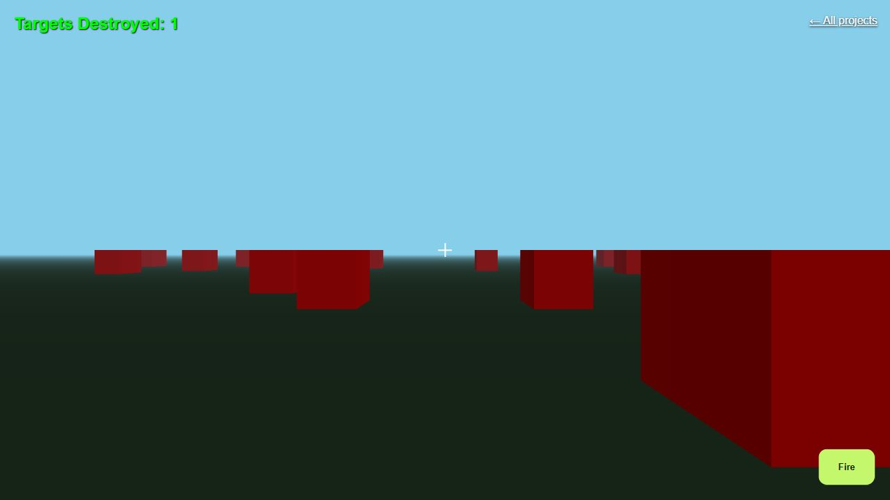

# AimForge 3D Trainer

A browser-based aim trainer built with Three.js and served by Flask. Move through a small 3D arena, aim at targets and track successful hits.

[Try the browser demo](https://lakshaywalia.com/demos/aimforge-3d-trainer/) · [Portfolio](https://lakshaywalia.com/projects.html)

## Run locally

```bash
python -m venv .venv
# Windows: .venv\Scripts\activate
# macOS/Linux: source .venv/bin/activate
python -m pip install -r requirements.txt
python app.py
```

Open <http://127.0.0.1:5000>. Alternatively:

```bash
docker build -t aimforge .
docker run --rm -p 127.0.0.1:5000:5000 aimforge
```

Choose captured-mouse controls, or keyboard controls when pointer capture is unavailable. Use WASD to move, arrow keys to aim in keyboard mode, and Space or the Fire button to shoot.

## Scope

This is a small playable demonstration, with raycast hit detection and a session score. It has no accounts, persistent player records, multiplayer service or production deployment platform. The Flask development server is intended for local demonstration.

The repository includes the required Three.js r160 browser modules and their MIT license under `static/lib/three`. No private configuration, databases or player data are needed.

## Project structure

```text
app.py                    Flask entry point
templates/index.html      Arena, controls and score
static/lib/three/         Three.js modules and upstream license
requirements.txt          Python dependencies
Dockerfile                Local demo container
```

## Verified gameplay

The screenshot below was captured from a fresh local Docker build. Keyboard mode opened successfully and firing at a target increased the score from 0 to 1.


